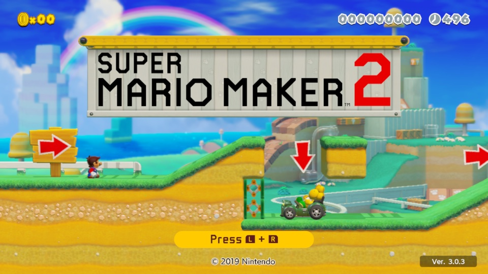
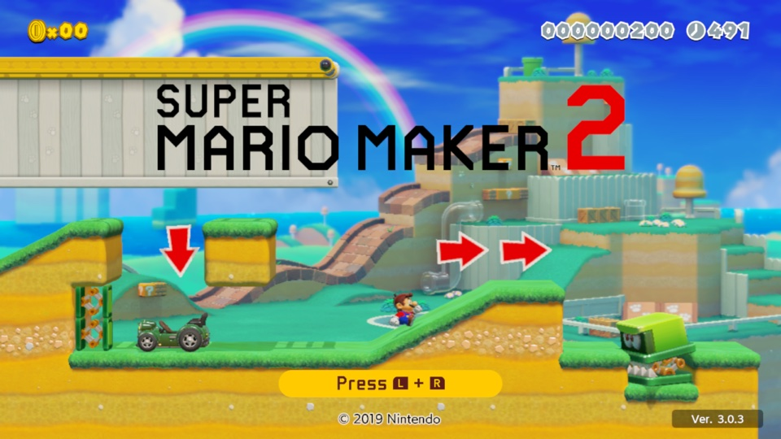
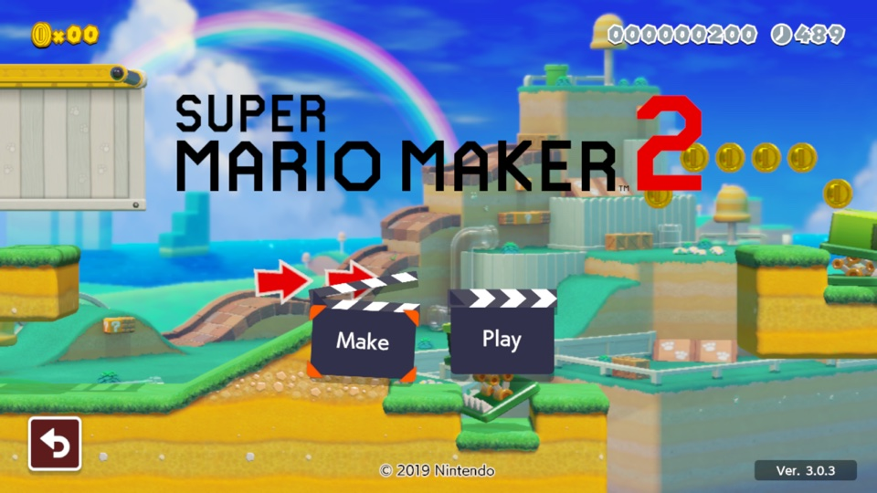
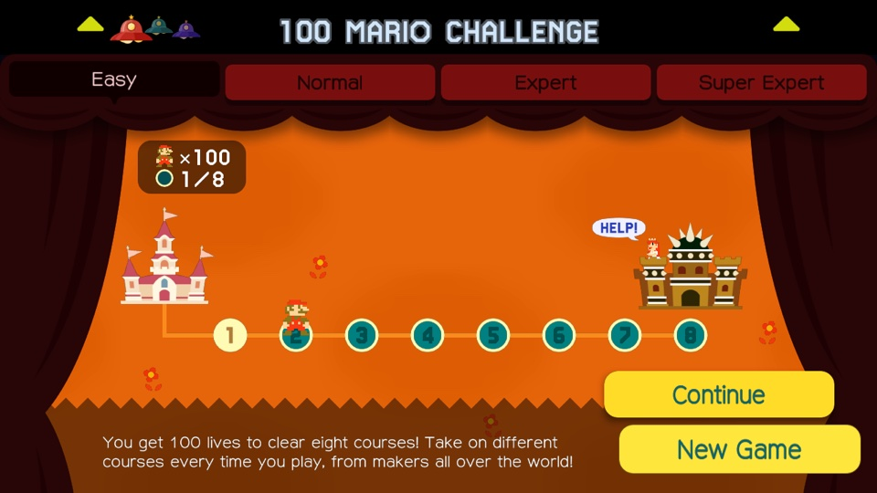
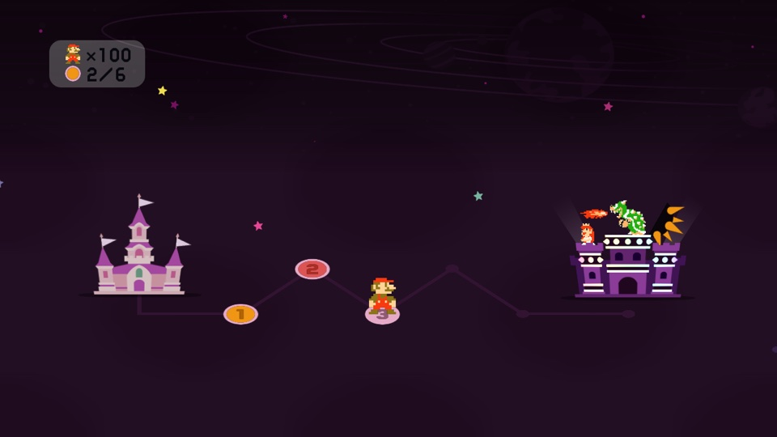
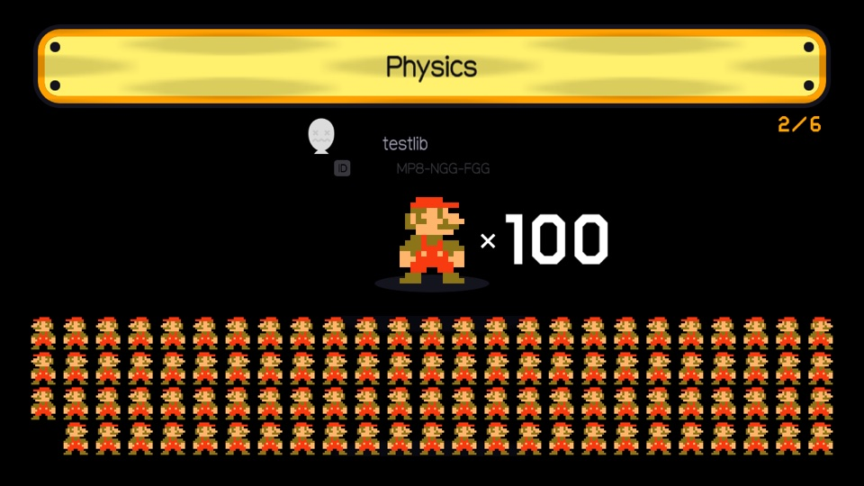
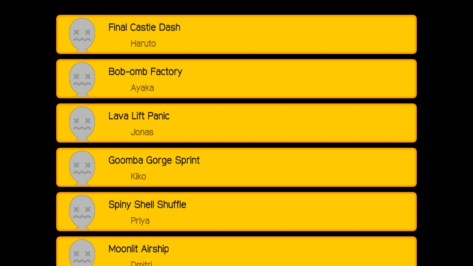

# SMM2 Recomp

A native port of **Super Mario Maker 2 v3.0.3**, built by **static recompilation** of your own
dump: the game's AArch64 code is translated to C ahead of time on your machine and compiled for
it, its system calls run on a native runtime, and its graphics run on Metal (macOS, iOS) or Vulkan
(Windows, Linux). SMM1's **100 Mario Challenge** (exactly as in SMM1, with SMM1's screens and ending, against
our open-source course server instead of Nintendo's) and **Mystery Mushroom costumes** come as mods.

**Nothing from the game is in this repository**: no code, assets, text, keys or recompiled output.
You supply your own dump; everything made from it is generated on your machine into gitignored
folders, and `scripts/check_no_proprietary.py` blocks it in CI and in a pre-commit hook.

**Status** (evidence per platform in [PROGRESS.md](PROGRESS.md)): on macOS (Apple Silicon) the game
boots and renders its title screen at 60 fps; title frames are within 2.5–4.8 % of pixels of
Ryujinx's. Playing courses with input replays checked frame by frame against Ryujinx, the 100
Mario mod, the Windows / Linux builds, iOS and costumes are in progress. Approach and the projects
it builds on (a fork of [LAS Recomp](https://github.com/peiikai/LASRecomp), MIT): the recomp entry
in [DECISIONS.md](DECISIONS.md).

## Screenshots

Captured from the macOS build, running from the owner's own dump.

| Title screen | Playing the title course | Make / Play |
|---|---|---|
|  |  |  |

**100 Mario Challenge mod** (in progress): SMM1's own screens, drawn from the player's SMM1 dump
over the recomp, with courses from our open-source server playing in SMM2's own course play.
Runs end after Easy 8 / Normal 16 / Expert 16 / Super Expert 6 clears with SMM1's ending; a full
Super Expert run plays from the select screen to THE END. (Course names in the credits come from a
test server.)

| Difficulty select | Super Expert map, 2 of 6 cleared | Start card, ×100 |
|---|---|---|
|  |  |  |

| The win: Peach's Super Expert thank-you | Credits: each cleared course and its maker |
|---|---|
|  |  |

## Layout

| Path | What |
|---|---|
| `recomp/` | the recompiler (`tools/`), the runtime (`runtime/`: kernel, services, NVN on Metal / Vulkan), SMM2's glue (`games/smm2/`) — see [recomp/README.md](recomp/README.md) |
| `core/` | the open-source course server (`mmk server`) the mods talk to: accounts, courses, leaderboards, Endless / 100 Mario runs, online-play relay |
| `smmfmt/`, `tests/` | Python reference for the course formats (`python -m smmfmt course.bcd`) |
| `docs/` | course formats, toolchain, self-hosting the server, Windows |
| `research/` | private reverse-engineering notes (gitignored; prose and tables, no game code) |

## Build and play (macOS, Apple Silicon)

Requirements: Xcode command line tools, Homebrew `sdl3` and `ffmpeg`, Python 3.12+, and your own
extracted dump (base RomFS, v3.0.3 update ExeFS and RomFS). About 2 GB of disk.

```sh
make -C recomp venv        # once: the recompiler's Python environment
make -C recomp smm2        # check the dump, recompile it to C on this machine, build (10–20 min the first time)
make -C recomp run-smm2    # play
```

Keyboard: WASD stick, arrows d-pad, K / J / L / I = A / B / X / Y, Q / E = L / R, 1 / 3 = ZL / ZR,
Enter / Backspace = + / −; F1 or Esc opens the overlay menu (video, audio, controls), F11 full
screen. Controllers work too. Details and options: [recomp/README.md](recomp/README.md).

## Windows

The SMM2 Recomp builds for Windows 10/11 x64 on Vulkan: `smm2recomp.exe`, cross-compiled from macOS with zig, and a
player package (`make -C recomp TARGET=windows-x86_64 GAME=smm2 DEPS=<deps> all package` ->
`dist/SMM2Recomp-windows-x86_64.zip`, nothing from the game in it). On first launch it recompiles the game code from
your own dump on your PC. **It has not been run on Windows yet.** [docs/windows.md](docs/windows.md) has the
requirements, the build, the first-launch dump setup and recompile, how to play, and troubleshooting.

## The course server

Self-hostable; it never talks to Nintendo's network. The recomp's 100 Mario mod uses it for
courses, runs and leaderboards (or a local one over your own course folder).

```sh
cd core
cargo run --release -p mmk-cli -- server --dir ./server-data --addr 0.0.0.0:8640
cargo run --release -p mmk-cli -- register Ada --server http://localhost:8640   # prints a token
cargo run --release -p mmk-cli -- upload --token <token> courses/*.bcd --keys <course key table>
```

[docs/self-hosting.md](docs/self-hosting.md) covers ports, HTTPS, accounts and moderation; the API
is at the top of `core/crates/server/src/lib.rs`.

## Development

```sh
scripts/install-hooks.sh     # pre-commit guard against proprietary files
scripts/check.sh             # the gates CI runs: server fmt / clippy / tests, recomp compile check, guard
```

Commits never contain game files; generated output stays in `recomp/private`, `recomp/generated`
and `recomp/build` (which may be symlinks to another disk).

## History and SMCraft (archived)

This repository started from a snapshot of
[aksmith-git/MarioMaker](https://github.com/aksmith-git/MarioMaker), which has the earlier
history. Before the recomp, that repository held **SMCraft**, a clean-room engine that played SMM2
courses with its own Rust core, a Swift app for macOS / iOS, a portable and web build, the SMM2
menus, a Course Maker and its own 100 Mario Challenge. It is kept, complete and building, on its
[`smcraft-archive`](https://github.com/aksmith-git/MarioMaker/tree/smcraft-archive) branch (tag
`smcraft-final`); mentions of that branch elsewhere in this repository mean that one.
